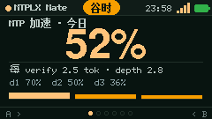
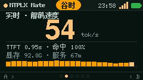

# MTPLX Mate

> 把 MTPLX 的**加速**和**省下的钱**放到一块 240×135 的桌面小屏上。



MTPLX Mate 是给 [MTPLX](https://github.com/youssofal/MTPLX)（Apple Silicon 本地推理）用户的桌面伴侣。
它能显示的东西在别的工具里看不到——**投机解码到底赚了多少**：

- **MTP 加速仪表**：今日接受率、每 verify 产出几个 token、depth 1/2/3 的接受概率曲线
- **实时速度**：当前 decode tok/s、TTFT、缓存命中、服务占用显存、最近 24 个采样点的波形
- **省钱折算**：同一批 token 如果走 DeepSeek 要多少钱，扣掉本地电费还剩多少
- **用量与趋势**：今日/昨日/7 天/30 天的 token、请求数、缓存命中率、逐模型排名

设备只负责显示；Mac 端 agent 读 MTPLX 的请求日志与实时接口，每 5 秒推一份快照过来。
MTPLX 的推理端口不需要对外暴露。

| MTP 加速 | 实时速度 | 省钱 |
|---|---|---|
|  |  |  |

---

## 你需要什么

| 项 | 要求 |
|---|---|
| 设备 | M5Stack StickS3（ESP32-S3，240×135） |
| Mac | Apple Silicon + macOS，已安装并跑过 **MTPLX**（日志里至少有一次请求） |
| MTPLX 版本 | 2.12+（用到 `/v1/mtplx/snapshot` 与 request-log） |
| Python | 3.9+（macOS 自带即可） |

> 还没有 MTPLX？先装它并跑一轮对话，否则 MTPLX Mate 只能显示配网/等待页。

---

## 使用流程

### 1. 烧固件

M5Burner 里搜 **MTPLX Mate**，或者用 esptool 写全片镜像：

```bash
esptool.py --chip esp32s3 write_flash 0x0 mtplx-mate-v0.1.0-merged.bin
```

自己编译：

```bash
pio run -e sticks3 -t upload --upload-port /dev/cu.usbmodem*
```

### 2. 配网（一次性）

首次上电，屏幕出二维码：

1. 手机连 `MTPLX-Mate-XXXX`（密码 `mtplxmate`）
2. 打开 `http://192.168.4.1`
3. 选 2.4GHz Wi-Fi、填密码、保存
4. 设备自动重启并连上

### 3. 在 Mac 上装 agent（一次性）

设备连上 Wi-Fi 后，屏幕会显示它自己的地址。在 Mac 上打开那个地址，复制页面里的命令执行：

```bash
curl -sL http://mtplx-mate-xxxx.local/setup.sh | bash
```

它会：检查 python3 → 把 `agent.py` 装到 `~/.mtplx-mate/` → 写一个 LaunchAgent 开机自启 →
立刻推一次快照并打开控制台。

### 4. 看数据

屏幕几秒内开始出数。控制台地址会写到 `~/.mtplx-mate/url.txt`（默认 `http://127.0.0.1:8799`）。

卸载：

```bash
curl -sL http://mtplx-mate-xxxx.local/uninstall.sh | bash
```

---

## 六个页面

默认顺序（可在控制台增删/重排）：

| # | 页面 | 显示什么 |
|---|---|---|
| 1 | **MTP 加速** | 大数字＝今日接受率；每 verify 产出 token、平均 depth；depth 1/2/3 接受概率柱 |
| 2 | **实时速度** | 大数字＝最新 decode tok/s；TTFT、缓存命中、显存、服务运行时长；24 点波形 |
| 3 | **省钱** | 今日已省（云账单 − 电费）、API 折算、电费、缓存省下多少 |
| 4 | **用量** | token 总量、请求数、缓存命中率、当前模型 |
| 5 | **趋势** | 选定区间的净省 + 30 天/7 天/小时柱图 |
| 6 | **模型** | 近 7 天各模型的账单占比 |

另有 **成本**（云账单/电费/缓存省/净省四宫格）与 **设备**（Wi-Fi、IP、服务版本、模型、电量）两页可加。

按键：

- **A** 下一页 / **B** 上一页
- 长按 **B** 重新配网
- 长按 **A** 无操作（防误触）

充电时只变暗不熄屏；电池供电 2 分钟无操作熄屏，按任意键唤醒。

## 控制台

`http://127.0.0.1:8799`（端口被占用会自动顺延，实际地址见 `url.txt`）：

- 4 张 KPI 卡：今日已省 / 今日 tokens / MTP 接受率 / 当前模型 + 实时 tok/s
- 30 天净省曲线
- **显示配置**：增删页面、选类型与区间、紧凑模式，带 240×135 实时预览
- **设备管理**：在线状态、电量、信号、当前页；远程翻页 / 闪烁 / 重启 / 移除
- 设置：对标模型（deepseek-flash / pro）、币种、电价、功率、折旧、推送间隔、语言

---

## 常见问题

**屏幕显示「连接 Mac」**

设备连上 Wi-Fi 了，但还没装 agent。按第 3 步执行那条 `curl` 命令。

**MTP 加速页一直是 `--`**

今天还没有请求，或者 MTPLX 最近一次生成没开 MTP。在 Mac 上跑一轮对话再看。

**实时速度显示 `--`**

MTPLX 服务没在跑（或不在 8001 端口）。`mtplx serve` 起来后会自己恢复。

**省钱数字是 0**

把 MTPLX 的请求日志喂进来需要一次真实请求：`mtplx ask "hi"`，然后等下一次推送（5 秒）。

**全片刷机后要重新配网**

M5Burner/esptool 写 `0x0` 的镜像会覆盖整个闪存（包括配置区）。只升级 app 分区可以保留配置：

```bash
esptool.py --chip esp32s3 write_flash 0x10000 .pio/build/sticks3/firmware.bin
```

---

## 它是怎么工作的

```
MTPLX (127.0.0.1:8001)                     StickS3 (ESP32-S3)
   │  ~/.mtplx/logs/request-log-*.jsonl        │
   │  /v1/mtplx/snapshot (本机)                │
   ▼                                           ▼
~/.mtplx-mate/agent.py  ──POST /api/snapshot──▶  8 种页面渲染
   (LaunchAgent 常驻)    ◀──state + cmd────────  A/B 翻页
   └── 127.0.0.1:8799 本地控制台
```

- **增量索引**：agent 只读日志新增的字节（按 inode+offset 记账），聚合成小时×模型的本地 SQLite，33 天回填一次
- **设备离线不影响数据**：Mac 端持续计算，设备一上线就收到最新快照
- **命令借推送的响应下发**：不需要 Mac 向设备开入站端口
- **令牌鉴权**：设备首次启动生成配对 token，只有拿到它的 agent 能推送

---

## 开发

```bash
pio run -e sticks3                    # 编译
pio run -e sticks3 -t upload          # 烧 app 分区（保留配置）
bash tools/make_release.sh            # 生成 merged 全镜像 + 结构校验 + sha256
python3 ~/.mtplx-mate/agent.py --once # 只算一次快照，不推送
python3 ~/.mtplx-mate/agent.py --serve --port 8799
```

固件与 agent 在同一个仓里：agent 会被 `tools/embed_assets.py` 编进固件，
所以设备能自己提供 `setup.sh` 与 `agent.py`（安装不依赖网络上的这份仓库）。

`docs/` 里有：数据源与协议（`SPEC-mtplx-data.md`）、省电行为（`SPEC-0.2.4-power.md`）、验收清单（`ACCEPTANCE.md`）。

## 许可

MIT。MTPLX 本身是独立的第三方项目（Apache-2.0），本仓不含 MTPLX 的代码。
